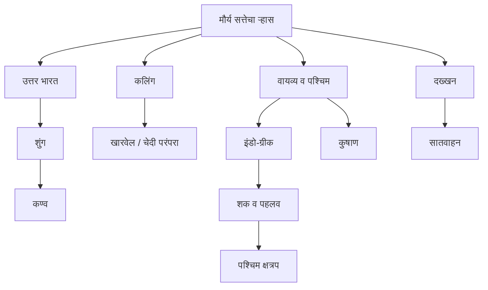
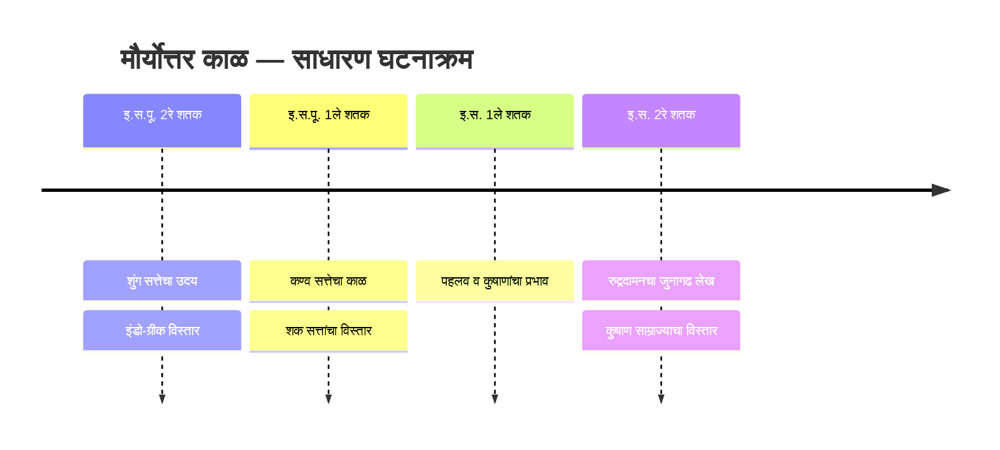

# HIS-009 — Visual Revision : मौर्योत्तर राजवंश

## 1. सत्तांचा प्रादेशिक नकाशा (संकल्पनात्मक)

## 2. स्रोत आणि त्यातून मिळणारी माहिती

| स्रोत | उदाहरण | मुख्य उपयोग | मर्यादा |
|---|---|---|---|
| साहित्य | हर्षचरित, महाभाष्य, मिलिंदपन्हो | राजकीय व धार्मिक परंपरा | नंतरचे लेखन/साहित्यिक उद्देश |
| अभिलेख | अयोध्या, बेसनगर, जुनागढ | दान, पदव्या, विजय, सार्वजनिक कामे | प्रशस्तीतील अतिशयोक्ती |
| नाणी | इंडो-ग्रीक, शक, कुषाण | राजा, भाषा, देवता, व्यापार | सापडण्याचे ठिकाण व चलनप्रसार काळजीपूर्वक समजावा |
| पुरातत्त्व | भरहूत, सांची, मथुरा | कला व धार्मिक संस्था | एका स्मारकावरून संपूर्ण धर्मजीवन ठरत नाही |

## 3. तुलनात्मक दृश्य

| सत्ता | ओळख | लक्षवेधी पुरावा |
|---|---|---|
| शुंग | पुष्यमित्र, वैदिक यज्ञ | अयोध्या लेख, महाभाष्य |
| कण्व | वासुदेव संस्थापक | पुराणीय राजसूची |
| इंडो-ग्रीक | यवन, द्विभाषिक नाणी | मेनांडर-मिलिंदपन्हो |
| पश्चिम क्षत्रप | शक, क्षत्रप/महाक्षत्रप | रुद्रदामनचा जुनागढ लेख |
| पहलव | पार्थियन | गोंडोफर्नेस नाणी |
| कुषाण | युएझी, बहुधार्मिक नाणी | कनिष्क, पुरुषपुर |

## 4. अभ्यासासाठी कालरेषा (साधारण)

कालरेषा ही अभ्यासासाठी साधारण आहे; प्रत्येक राजवंशाच्या अचूक तारखा स्रोतांनुसार बदलतात.
