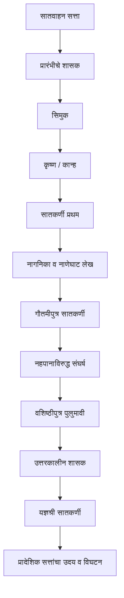

# HIS-010 — Visual Revision : सातवाहन राजवंश

## 1. राजकीय घडामोडी (संकल्पनात्मक)

## 2. स्रोतांची तुलना

| स्रोत | उदाहरण | उपयोग | काळजी |
|---|---|---|---|
| पुराणे | मत्स्य, वायु, विष्णु | राजसूची व कालावधी | याद्यांमध्ये फरक |
| अभिलेख | नाणेघाट, नाशिक, कार्ले | दान, वंश, राजकीय दावे | प्रशस्तीतील स्तुती लक्षात घ्या |
| नाणी | शिसे, पोटिन, चांदी | राजा, व्यापार, प्रदेश | नाणे-सापडण्याचे ठिकाण महत्त्वाचे |
| साहित्य | गाथासप्तशती, बृहत्कथा परंपरा | भाषा व सांस्कृतिक जीवन | परंपरागत श्रेय व रचनाकाल तपासा |
| परकीय लेखन | Periplus | बंदरे व व्यापार | व्यापाऱ्याचा दृष्टिकोन लक्षात घ्या |

## 3. स्थळे व महत्त्व

| स्थळ | आधुनिक संदर्भ | अभ्यासमूल्य |
|---|---|---|
| प्रतिष्ठान | पैठण, महाराष्ट्र | राजकीय केंद्र व व्यापारी मार्ग |
| नाणेघाट | पश्चिम घाट | नागनिका लेख; घाटमार्ग |
| नाशिक | महाराष्ट्र | राजकीय प्रशस्ती व दानलेख |
| कार्ले | महाराष्ट्र | चैत्यगृह व व्यापारी दान |
| जोगलथेंबी | नाशिक परिसर | नहपानाची पुनर्मुद्रित नाणी |
| अमरावती | आंध्र प्रदेश | बौद्ध स्तूप व शिल्पकला |

## 4. व्यापाराचा मार्ग — संकल्पनात्मक

हा संकल्पनात्मक मार्ग आहे; प्रत्येक वस्तू याच एकाच मार्गाने गेली असे समजू नये.

## 5. धार्मिक आश्रयातील विविधता

| पुरावा | काय दिसते? |
|---|---|
| अश्वमेध/राजसूय उल्लेख | वैदिक यज्ञपरंपरेचा राजाश्रय |
| नाशिक/कार्ले दानलेख | बौद्ध संघ व गुंफा संस्थांना दान |
| स्त्रियांचे दान | राणी, व्यापारी व गृहस्थ स्त्रियांचा सहभाग |

सातवाहनांनी एकाच धार्मिक परंपरेला सर्वत्र अनिवार्य केले असे निष्कर्ष काढू नका.
